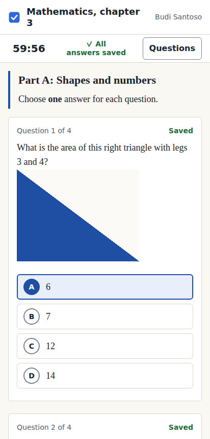
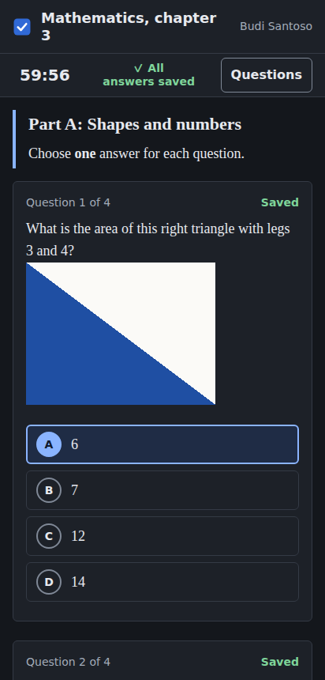
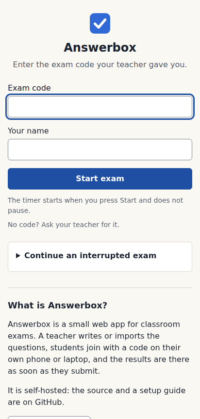
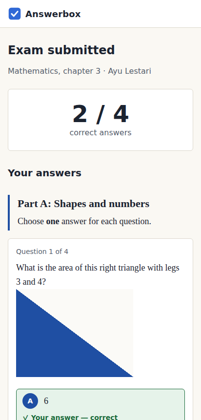
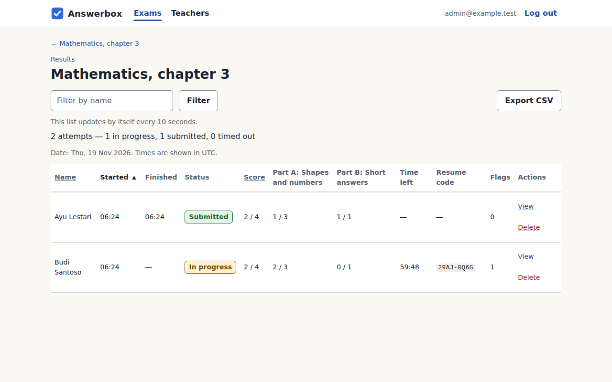
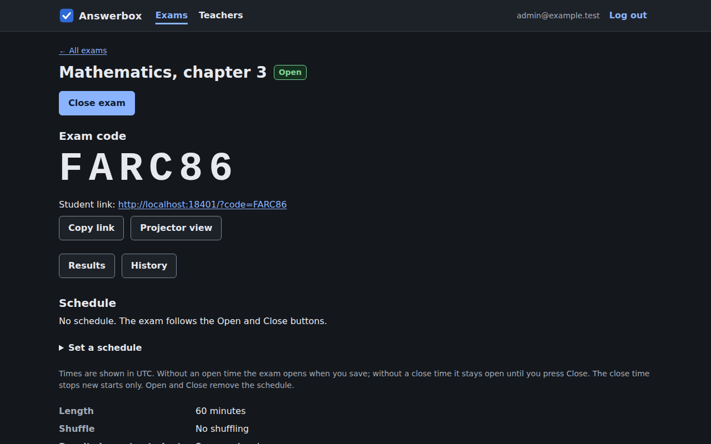

# Answerbox

Answerbox is a small, self-hosted web app for classroom exams with multiple-choice and fill-in questions. It is for a teacher who wants to run a short test in class on the phones and laptops students already have, without accounts for the students: they type the exam's code and their name, or open a link that carries the code, and take that exam within its time limit. The teacher imports exams from text files or writes them in the browser, opens and closes them by hand or on a schedule, and reads the results as they come in. It is not a learning platform.

<p>
  
  
  
</p>

## What it does

For students:

- Join with a 6-character code and a name, or with a link that carries the code; no account.
- One page with every question, a timer, a save state for each answer and a navigator; answers save on their own.
- A short typed answer for fill-in questions.
- The score, or the score and a review of every answer, when the exam allows it.
- Continue an interrupted exam with a resume code, also on another device.

For teachers:

- Sign in with Google; only emails on the app's teacher list may sign in. Each teacher sees only their own exams and results; admins (the emails in `ANSWERBOX_ADMIN_EMAILS`) also see every exam and manage the teacher list.
- Import an exam from a text file (with images in a zip) or write it in the browser, with sections and instructions.
- Open and close exams by hand or on a schedule; several exams can be open at the same time.
- Show the code to the room with the projector view, or send the student link.
- Read the results as they come in, sort and filter them, export a CSV, and look at every answer of an attempt.
- An optional monitor reports when a student leaves the exam page or tries to copy or paste.
- Every change to an exam is a numbered revision; exams can be downloaded, copied and archived.

| | |
| --- | --- |
|  |  |
| The start page | A student's result with the review |
|  |  |
| The exams list | Results, updated while students work |
|  |  |
| The editor | The projector view (dark) |
|  | |
| The exam page (dark) | |

## Quick start

Try it on your own computer with the fake sign-in provider. You need Go 1.26 or later.

In one terminal, start the fake provider:

```sh
go run ./cmd/oidcfake
```

In a second terminal, start Answerbox:

```sh
ANSWERBOX_GOOGLE_CLIENT_ID=dev-client ANSWERBOX_GOOGLE_CLIENT_SECRET=dev-secret \
ANSWERBOX_ADMIN_EMAILS=admin@example.test ANSWERBOX_PUBLIC_URL=http://localhost:8080 \
ANSWERBOX_OIDC_ISSUER=http://127.0.0.1:9096 ANSWERBOX_DATA_DIR=./data go run ./cmd/answerbox
```

Then:

1. Open `http://localhost:8080/admin` and press Sign in with Google; on the fake page, sign in as `admin@example.test`.
2. Press Import from file, choose [`docs/sample-exam.md`](docs/sample-exam.md) and press Import exam.
3. On the exam's page, press Open exam and note the exam code.
4. Open `http://localhost:8080/` in a private window, type the code and a name, and press Start exam.

> **Warning:** the fake provider signs in anyone with any email. It is for trying the app on your own computer and is not part of the container image.

## Self-hosting

### Run with a container

The image is published as `ghcr.io/fiatcode-gh/answerbox`. It contains a single static binary, runs as uid/gid 65532 (non-root) and keeps its data in `/data`.

```sh
podman build -t localhost/answerbox:dev -f Containerfile .
podman volume create answerbox-data
podman run -d --name answerbox -p 8080:8080 \
  --env-file .env \
  -v answerbox-data:/data \
  ghcr.io/fiatcode-gh/answerbox:latest   # or localhost/answerbox:dev
```

Open `http://localhost:8080/` for students and `http://localhost:8080/admin` for the teacher.

### Settings

All configuration comes from environment variables.

| Variable | Default | Meaning |
| --- | --- | --- |
| `ANSWERBOX_GOOGLE_CLIENT_ID` | none (required) | OAuth client ID of the Google Cloud "Web application" client. |
| `ANSWERBOX_GOOGLE_CLIENT_SECRET` | none (required) | Client secret of that OAuth client. |
| `ANSWERBOX_ADMIN_EMAILS` | none (required) | Comma-separated Google account emails of the admins. The first one receives the exams that existed before teacher accounts. |
| `ANSWERBOX_PUBLIC_URL` | none (required) | Public address of the app, scheme and host without a path, for example `https://exam.example.org`; `https` unless the host is localhost. The student link shown to teachers starts with it. |
| `ANSWERBOX_OIDC_ISSUER` | `https://accounts.google.com` | OpenID provider; `https` unless the host is localhost. Set it only for another provider or the local fake used in tests. |
| `ANSWERBOX_DATA_DIR` | `./data` (image: `/data`) | Directory holding the database and uploaded images. |
| `ANSWERBOX_LISTEN_ADDR` | `:8080` | Address the HTTP server listens on. |
| `ANSWERBOX_TRUSTED_PROXIES` | empty (trust nobody) | Comma-separated CIDRs or IPs whose `X-Forwarded-For` is trusted for the client address in the request log. |
| `ANSWERBOX_TIME_ZONE` | `UTC` | IANA time zone used to display times, to type and show schedule times, and for the open time students read (time zone data is built in). |

The app refuses to start without the four required settings. It also refuses to start while a variable with the prefix the app used before it was renamed (2026-11-19) is set, and the message names the ANSWERBOX_ key to use instead. [`.env.example`](.env.example) lists every setting with a one-line explanation; the optional ones stay commented out, because an empty value in an env file overrides the default (for example the image's `/data`). Teacher sessions last 12 hours and survive restarts. The admin role follows `ANSWERBOX_ADMIN_EMAILS` at every request; an email taken out of it stays an ordinary teacher until an admin removes it on the Teachers page. Recovery is an environment change plus a restart: there is no password.

### Google sign-in

1. In Google Cloud, create an OAuth client of type "Web application".
2. Add the authorised redirect URI `<ANSWERBOX_PUBLIC_URL>/admin/auth/callback`, for example `https://exam.example.org/admin/auth/callback`.
3. The app asks for the `openid`, `email` and `profile` scopes.
4. Put the client ID and secret in `ANSWERBOX_GOOGLE_CLIENT_ID` and `ANSWERBOX_GOOGLE_CLIENT_SECRET`.
5. The first admin signs in at `/admin` and adds teachers on the Teachers page.

A Google account can sign in only when its email is verified and on the teacher list. On the Teachers page, Remove asks on a confirmation page before it takes a teacher off the list; admins have no Remove.

### Behind a reverse proxy

- The app speaks plain HTTP; let the proxy terminate TLS and forward to port 8080.
- Cookies are always `Secure`, so students and the teacher must reach the app over HTTPS (browsers also accept `http://localhost` for local use).
- Set `ANSWERBOX_TRUSTED_PROXIES` to the proxy's network (for example `172.18.0.0/16`) so the request log shows real client addresses instead of the proxy's.
- The server needs outbound HTTPS to Google to sign teachers in. Students are not affected when Google cannot be reached.

### Data and backup

Everything lives under the data directory:

- `answerbox.db` — the SQLite database (WAL mode, so `answerbox.db-wal` and `answerbox.db-shm` may sit next to it);
- `media/` — images imported with exams, kept for every revision: Replace no longer removes the old images, so this folder grows with each Replace.

If the data directory holds a database file under the name the app used before it was renamed and no renamed file next to it, the app refuses to start and says which files to rename while it is stopped.

To back up while the app is running, take an online copy of the database and copy the media directory:

```sh
sqlite3 "$db" ".backup '$dest'"
cp -a "$data/media" "$backup/"
```

### Health check

`GET /healthz` returns `200` with body `ok` when the server and database are available, and `503` otherwise.

### Browser support

Tested in Chromium on desktop and in Chrome on a real Android phone. Safari (iPhone, iPad, Mac) is not tested.

## Using Answerbox

### Look

The pages follow the device's light or dark setting; there is no switch. Every teacher page and the start page work without scripts: a script only adds Copy link on the exam page and the updating results list.

### Exam codes

- Every exam gets a 6-character code when it is imported: capital letters and digits without look-alikes (no I, L, O, U, 0, 1). The code never changes, also when the questions are replaced and across revisions, and no other exam ever gets it. A copy of an exam gets a new code.
- The exam page shows the code and the student link `<ANSWERBOX_PUBLIC_URL>/?code=XXXXXX`; Copy link puts the link on the clipboard. Projector view shows the address and the code large, for the room. The exams list shows each exam's code.
- Students open the app and type the code and their name. Any case works, and spaces and a dash are ignored. With the link, the name is all they type.
- A code works only while its exam is open. Otherwise the student reads "No open exam has that code. Check it with your teacher.", the same sentence for a mistyped code, for a closed exam and for an exam whose close time has passed.
- A code of a scheduled exam that is not open yet shows the exam's title and when it opens, for example "This exam opens at 08:00." (with the date when that is not today), both through the student link and after pressing Start. The student starts once the open time has come.
- Several exams can be open at once; opening one never closes another. Closing an exam stops new starts only; attempts in progress continue.
- Open exam and Close exam on the exam page keep the teacher on that page; Open and Close in a row of the exams list keep them on the list.
- A student with an exam in progress is sent back to it. A resume code needs no exam code.
- Exams imported before this version get their code the first time the new version starts.

### Schedule

- The exam page has a Schedule section with an open time and a close time; its form opens from "Set a schedule" (or "Change the schedule" when one is set). Save schedule sets them; the exams list shows them under the exam's status.
- Either time may be empty. Without an open time the exam opens as soon as the schedule is saved; without a close time it stays open until the teacher presses Close.
- The close time must be after the open time and in the future. An open time in the past opens the exam at once.
- The exam is open exactly from the open time until the close time; at the close time itself it is closed.
- The close time stops new starts only. Attempts in progress keep their full length.
- Open and Close remove the schedule and leave the exam open or closed. Saving a schedule on an exam opened with the button hands it to the schedule.
- Times are typed and shown in `ANSWERBOX_TIME_ZONE`.

### Archive

- Archive, on the exam page, works for any exam the teacher can see: open or closed, with or without attempts. It asks on a confirmation page first; Unarchive is one press and is the undo.
- Archiving closes the exam and removes its schedule. Attempts in progress continue to their own deadline; new starts are refused with the same sentence as for a mistyped code.
- Archived exams leave the exams list. "Show archived" lists every exam, with archived ones marked `Archived`; "Hide archived" returns to the usual list. When every exam is archived, the list says "All exams are archived."
- The exam page of an archived exam shows `Archived` and the date it was archived, in `ANSWERBOX_TIME_ZONE`. Open and Save schedule are refused until the exam is unarchived.
- Results, the CSV, renaming and deleting attempts, History, Download and Copy keep working on an archived exam, and so do Edit questions and Replace while it has no attempts. A copy of an archived exam is not archived.
- Unarchive returns the exam closed and without a schedule; it does not bring back an earlier schedule.
- Archive is per exam, for everyone who can see it: an admin who archives a teacher's exam hides it from that teacher's list too.
- Rolling back to the previous version (before archive): archived exams show as closed there, and its Open and Save schedule on them answer an error page and change nothing. Unarchive with this version first.

### Editor

- The exams list has New exam and Import from file at the top; the import form sits under the list.
- New exam writes an exam in the browser: its title, settings and first question. The new exam is closed and opens on its editor page.
- Edit questions, on the exam page, lists the questions with Edit, Move up, Move down and Remove, plus Add question and Settings (title, shuffle, result shown, monitor, length). Remove asks on a confirmation page. A question form is multiple choice or fill-in; "Switch to fill-in" and "Switch to multiple choice" change it without saving. A multiple-choice form holds the question text, two to ten options and the correct one; Add option, Remove, Up and Down change the list without saving, and Enter in a text field saves. A fill-in form holds the question text and one to ten accepted answers; Add accepted answer and Remove change the list without saving. The form keeps both lists until you save, so switching back loses nothing; only the shown kind is saved.
- The editor works only for an exam without attempts. Once a student has started, the exam is frozen as before.
- A form opened before another save of the same exam (in another tab or by another teacher) is refused: "This exam changed since you opened this page. Nothing was saved." The typed text stays in the form; reopen the question to see the current version.
- A question form can add an image (PNG, JPEG, GIF or WebP, up to 5 MB). Saving adds a line such as `` (a name made from the file's content) at the end of the question text; move that line to place the image elsewhere, also into an option. When the end of the question text would hide that line (for example raw HTML there), the save is refused and no file is kept. A refused save cannot keep the chosen file, so choose it again.
- The text is the exam file format: `**bold**`, `*italics*`, `` `code` ``, fenced code blocks and image lines work as in a file, and the same rules refuse a save (for example an empty question or option). Write `\-` or `\*` for a line starting with `-` or an option ending with `*`. Text is stored as a file would be, without trailing spaces. A question or option that begins with a code block is stored with an empty first line and shows that way when opened again. A first line that starts with three backticks always opens a code block, so inline code there takes one backtick (`` `x` ``, not ```` ```x``` ````).
- A save that changes nothing makes no revision.

### Sections

- A section is a named part of an exam: a title and, if the teacher writes them, instructions, shown above its first question. Question numbers run on across sections. An exam without sections works as before.
- In an exam file a line `## Title` at the start of a line starts a section. The lines after it, up to the next question number, are its instructions, in the same text format as questions, images included; there a line starting with `- ` is a list item and a `shuffle:` line is text. The settings lines go before the first heading, and the first section starts at question 1. A `## ` line inside a code block, an indented one and `###` are ordinary text.
- Students see each section's title and instructions above its first question, on the exam page and in the review. The navigator still lists the questions 1, 2, 3, … without sections.
- With shuffling on, the questions are shuffled inside each section, and the sections keep their order. Options shuffle as before.
- The score page shows the total only. The teacher's exam page, each revision and the attempt page show the headings.
- For an exam with sections, the results list has one column per section after the Score column, headed by the section's title (`correct / questions in the section`), and the CSV one column per section after `total`, holding the number of correct answers. An exam without sections has no extra columns.
- In the editor, a question that does not start a section has "Start a section here"; in an exam without sections only question 1 has it, because the first section starts there. Each section has Edit section (title, instructions and an image upload, like a question) and Remove section, which asks on a confirmation page and then joins its questions to the section before (or, for section 1, to the next one).
- Move up on a section's first question puts it at the end of the section before, and Move down on a section's last question puts it at the start of the next one; the question keeps its number and the boundary moves. A section's only question has no Move or Remove until the section is removed. Add question adds to the end of the last section.
- A section is refused when it has no questions, an empty title, a title over 200 characters or a line break in the title, when there are more than 50 sections, and when other text comes before the first heading or question 1. The editor says, for example, "section 2 would be left without questions; remove the section first".
- Sections are part of the questions: they are frozen once an attempt exists, and Download, Copy and every revision keep them.
- Rolling back to the previous version (before sections): exams without sections work as before. An exam with sections shows no section titles or instructions there, its shuffle mixes all its questions, its results show the total only, and an attempt in progress gets another question order (answers and scores are safe). Its editor save or Replace on such an exam without attempts stores it without sections (the earlier revisions keep them), and its Download and Copy leave them out. Before rolling back, list the exams with sections:

  ```sh
  sqlite3 "$db" "SELECT DISTINCT e.code FROM exam e JOIN question q ON q.exam_id = e.id WHERE q.section_title IS NOT NULL"
  ```

  close each one, let its running attempts end, and do not edit, replace, copy or download them until this version is back.

### Fill-in questions

- A fill-in question has no options: the student types a short answer. The teacher lists 1 to 10 accepted answers, and a typed answer is right when it matches one of them. An exam can mix fill-in and multiple-choice questions, also inside sections.
- Matching ignores capital letters and extra spaces (before, after and between words). Accents and punctuation count. Numbers written the Indonesian way match by value: `1.003` matches `1003`, `0,50` matches `0,5` and `007` matches `7`. `1.5` and `1.00` are not numbers that way, so they match only the same text.
- The student sees a text box under the question, up to 200 characters. It saves on its own after a short pause in typing and when the student leaves the box, with the same saved state and retry as a picked option. Clearing the box makes the question unanswered again. With the monitor on, pasting or dropping text into the box is blocked and reported as a paste; typing is not. With `show_result: review` the student's review shows their answer, whether it counted as correct, and the accepted answers.
- The attempt page shows the typed answer, the accepted answers and the automatic mark. Once the attempt has ended, Mark right or Mark wrong overrides that mark, and Remove override returns to it; only the latest mark is kept, with who set it and when. An override changes the score everywhere: the attempt page, the results list, the section columns, the CSV and the student's result page. It works on frozen and archived exams and makes no revision. Unanswered questions and attempts in progress cannot be marked, and the student is not told.
- The CSV has scores only, no typed answers.
- Rolling back to the previous version (before fill-in questions): multiple-choice exams work as before. Fill-in questions show there without an answer box and count as wrong, so the scores of fill-in exams read too low; its editor save of a fill-in question is refused, its Download leaves the accepted answers out and its Copy answers an error page. Typed answers and overrides are kept and count again when this version is back. Before rolling back, list the exams with fill-in questions:

  ```sh
  sqlite3 "$db" "SELECT DISTINCT e.code FROM exam e JOIN question q ON q.exam_id = e.id WHERE q.accepted_answers IS NOT NULL"
  ```

  close each one, let its running attempts end, and do not read their results, download, copy, replace or delete attempts of them until this version is back.

### Revisions, download and copy

- Importing an exam makes its revision 1; each Replace and each editor save makes the next one. Revision 1 carries exactly the exam's creation time. A revision records its number, the time, the teacher and a summary: `Imported`, `Replaced from file`, `Copied from <title> (<code>), revision <N>`, or for an editor save `Created in the editor`, `Question N edited` (with `; correct option changed` when the correct option's text changed, or `; accepted answers changed` when a fill-in question's accepted answers changed), `Question N added`, `Question N removed`, `Question N moved to M`, `Question N moved to section K`, `Section K started at question N`, `Section K edited`, `Section K removed` or `Settings changed: ` and the changed settings. Sections are named by their position, as questions are.
- History, on the exam page, lists the revisions newest first. Any revision opens read-only with its settings, questions, correct options and images.
- Once an exam has an attempt it is frozen: no Replace, no editor save and no new revision. To change it, copy it.
- Each attempt records the revision it started on; the attempt page shows it as a link to that revision. The results list and the CSV do not show it.
- Download gives the current revision as `exam-<CODE>.md`, or `exam-<CODE>.zip` when the exam has images, also for a frozen exam. The file is in a standard layout: all four settings lines, questions numbered from 1, the correct option marked ` *`; the words of questions and options stay as typed. Importing it gives an equal exam.
- Copy exam makes a new closed exam with a new code and the same title, owned by whoever pressed Copy, starting at revision 1. Attempts, schedule and the open state are not copied.
- Exams imported before this version get revision 1 `Imported` the first time the new version starts, dated at their import, and their existing attempts are put on it. Their text is rebuilt from the stored pages, so a special character may come back with a backslash (for example `2\*3`), which shows the same; their images are named by content hash in a download. An exam whose text cannot be rebuilt exactly (it uses a list, link, quote, heading or raw HTML, bold-and-italic text written as `**_x_**` or `__*x*__`, or a paragraph ending in a no-break space) keeps working but has no history, download or copy; the exam page says so and the server log names the exam and the question at every start.
- Rolling back to the previous version (before the editor): edited exams keep working there like replaced ones (student pages, results, History, Download and Copy); it has no editor, so New exam and Edit questions are gone and their pages answer 404.
- Rolling back to the version before revisions: everything keeps working except Replace on an exam that has a revision, which is refused and changes nothing.

### Results

- Results, on the exam page and in each row of the exams list, lists every attempt with its status, score, a column per section, the time left and resume code of an attempt in progress, and the monitor's flags. View opens an attempt with every answer.
- The list is in start order; the Name and Score headings sort it, and pressing a heading again reverses it. The name filter keeps the sort, and Show all clears the filter.
- Export CSV downloads the scores of every attempt.
- Delete, in a row, asks on a confirmation page before it removes the attempt.
- While an attempt is in progress, the exam is open or its open time is still ahead, the list updates by itself every 10 seconds and keeps the filter and the sort. Without scripts, a reload does the same.

### Exam file format

Upload either one text file (`.md` or `.txt`) or a `.zip` containing the text file plus the images it references. A complete example:

````markdown
# Chapter 3 quiz
shuffle: questions, options
show_result: review

1. What is the **area** of this triangle?

- 6 *
- 7
- 12
- 14

2. What does this program print?
```
fmt.Println(2 + 3)
```
- `5` *
- `23`
- `2 + 3`
````

An exam with two sections; the lines after a heading, up to the next question, are its instructions:

```markdown
# Chapter 4 quiz
shuffle: questions

## Part A: Multiple choice
Choose **one** answer.

1. What is 2 + 3?
- 5 *
- 6

## Part B: Word problems

2. Ann buys 4 pens at 2 dollars each. What does she pay?
- 8 dollars *
- 6 dollars
```

A fill-in question lists its accepted answers on `=` lines instead of options:

```markdown
# Chapter 5 quiz

1. What is the capital of Indonesia?
= Jakarta
= DKI Jakarta

2. How much is 1.000 + 3?
= 1.003
```

Rules:

- The first line is the title: `# Title`.
- Optional settings follow the title: `shuffle: none | questions | questions, options` (default `questions`), `show_result: none | score | review` (default `score`), `monitor: on | off` (default `on`) and `duration: <minutes>` (the time limit, a whole number from 5 to 240, default `60`). Like the questions, the length is fixed once an attempt exists.
- With `monitor: on`, the exam page blocks copy, cut, paste and the right-click menu, and reports to the teacher when the student leaves the page for more than 3 seconds, tries one of those blocked actions or resizes the window. The student sees "Your teacher has been notified." after each event, and the page asks the browser to keep the screen on. The teacher sees the count in the results list (Flags) and CSV (`flags`), and each event on the attempt page. The monitor cannot see other apps, other devices, screenshots or browser extensions; it discourages cheating, it does not prevent it. Events never change answers, time or score.
- Questions are numbered `1.`, `2.`, … at the start of a line.
- A line `## Title` before a question starts a section; the lines after it, up to the next question number, are the section's instructions. See [Sections](#sections).
- Options start with `- `. Each multiple-choice question needs at least two.
- Mark exactly one option per question as correct with a trailing `*`.
- Lines starting with `= ` list a fill-in question's accepted answers: 1 to 10 per question, each one line of plain text, up to 200 characters. A question has either options or accepted answers, never both. An `=` line indented 8 or more columns (a tab counts 4), inside a code block or in a section's instructions is text. See [Fill-in questions](#fill-in-questions).
- Text supports bold (`**bold**`), italics (`*italics*`), inline `` `code` ``, line breaks, fenced code blocks (```` ``` ````) and images (``).
- To use images, upload a `.zip` containing the text file and the image files (PNG, JPEG, GIF or WebP). File names inside the zip must be valid UTF-8, which every current zip tool writes.
- Uploads are limited to 10 MB and must finish within 60 seconds, which needs an upload speed of about 1.4 Mbit/s for a 10 MB file.

[`docs/sample-exam.md`](docs/sample-exam.md) is a small complete exam to start from.

## Development

```sh
gofmt -l .                                              # must print nothing
go vet ./...
go run honnef.co/go/tools/cmd/staticcheck@v0.8.2 ./...
go test ./...
go test -race ./...
podman build -t localhost/answerbox:dev -f Containerfile .

# Run with your own settings from .env (never printed):
( set -a; . ./.env; set +a; exec go run ./cmd/answerbox )

# Or run against the fake OpenID provider (tests, load test, browser scripts).
# The app must be reached as localhost and the provider as 127.0.0.1.
go run ./cmd/oidcfake                                   # serves on 127.0.0.1:9096
ANSWERBOX_GOOGLE_CLIENT_ID=dev-client ANSWERBOX_GOOGLE_CLIENT_SECRET=dev-secret \
ANSWERBOX_ADMIN_EMAILS=admin@example.test ANSWERBOX_PUBLIC_URL=http://localhost:8080 \
ANSWERBOX_OIDC_ISSUER=http://127.0.0.1:9096 ANSWERBOX_DATA_DIR=./data go run ./cmd/answerbox

go run ./cmd/loadtest -base-url http://localhost:8080 -teacher-email admin@example.test
# Each browser script expects a fresh data directory:
uv run e2e/student_ui.py --base-url http://localhost:8080 --admin-email admin@example.test --oidc-url http://127.0.0.1:9096 --out e2e/out/student-ui
uv run e2e/exam_flow.py  --base-url http://localhost:8080 --admin-email admin@example.test --oidc-url http://127.0.0.1:9096 --out e2e/out/exam-flow
uv run e2e/monitor.py    --base-url http://localhost:8080 --admin-email admin@example.test --oidc-url http://127.0.0.1:9096 --out e2e/out/monitor
uv run e2e/teachers.py   --base-url http://localhost:8080 --admin-email admin@example.test --oidc-url http://127.0.0.1:9096 --out e2e/out/teachers
uv run e2e/exam_codes.py --base-url http://localhost:8080 --admin-email admin@example.test --oidc-url http://127.0.0.1:9096 --out e2e/out/exam-codes
uv run e2e/revisions.py  --base-url http://localhost:8080 --admin-email admin@example.test --oidc-url http://127.0.0.1:9096 --out e2e/out/revisions
uv run e2e/editor.py     --base-url http://localhost:8080 --admin-email admin@example.test --oidc-url http://127.0.0.1:9096 --out e2e/out/editor
# Rollback rehearsal: start the previous release's binary on a copy of the data directory editor.py left, then:
uv run e2e/editor.py --rollback --base-url http://localhost:8080 --admin-email admin@example.test --oidc-url http://127.0.0.1:9096 --out e2e/out/editor-rollback
uv run e2e/archive.py    --base-url http://localhost:8080 --admin-email admin@example.test --oidc-url http://127.0.0.1:9096 --out e2e/out/archive
# Rollback rehearsal: start the previous release's binary (5716eb8) on a copy of the data directory archive.py left, then:
uv run e2e/archive.py --rollback --base-url http://localhost:8080 --admin-email admin@example.test --oidc-url http://127.0.0.1:9096 --out e2e/out/archive-rollback
uv run e2e/sections.py   --base-url http://localhost:8080 --admin-email admin@example.test --oidc-url http://127.0.0.1:9096 --out e2e/out/sections
# Rollback rehearsal: start the previous release's binary (293ab19) on a copy of the data directory sections.py left, then:
uv run e2e/sections.py --rollback --base-url http://localhost:8080 --admin-email admin@example.test --oidc-url http://127.0.0.1:9096 --out e2e/out/sections-rollback
uv run e2e/fillin.py     --base-url http://localhost:8080 --admin-email admin@example.test --oidc-url http://127.0.0.1:9096 --out e2e/out/fillin
# Rollback rehearsal: start the previous release's binary (1bddec5) on a copy of the data directory fillin.py left, then:
uv run e2e/fillin.py --rollback --base-url http://localhost:8080 --admin-email admin@example.test --oidc-url http://127.0.0.1:9096 --out e2e/out/fillin-rollback
# Then start this release on that copy again:
uv run e2e/fillin.py --returned --expect-csv e2e/out/fillin/attempts.csv --base-url http://localhost:8080 --admin-email admin@example.test --oidc-url http://127.0.0.1:9096 --out e2e/out/fillin-returned
# The server must run with ANSWERBOX_TIME_ZONE=Asia/Jakarta; the run waits about two minutes on the real clock:
uv run e2e/scheduled_exams.py --base-url http://localhost:8080 --admin-email admin@example.test --oidc-url http://127.0.0.1:9096 --time-zone Asia/Jakarta --out e2e/out/scheduled-exams
# Every teacher page without scripts, the student exam and the teacher's controls by keyboard, a 360 px phone, both colour schemes:
uv run e2e/walkthrough.py --base-url http://localhost:8080 --admin-email admin@example.test --oidc-url http://127.0.0.1:9096 --out e2e/out/walkthrough
# Every page in both colour schemes at 412 and 1280 px (classroom pages also at 360), with a sideways-scroll check;
# --readme rewrites the README pictures:
uv run e2e/screenshots.py --base-url http://localhost:8080 --admin-email admin@example.test --oidc-url http://127.0.0.1:9096 --out e2e/out/screenshots --readme docs/screenshots

# Check that every exam in a database copy can be given its revision 1 (read-only; use a copy taken with sqlite3 ".backup"):
go run ./cmd/rebuildcheck -db /path/to/copy.db
```

The fake provider signs in any identity and is not part of the container image.
