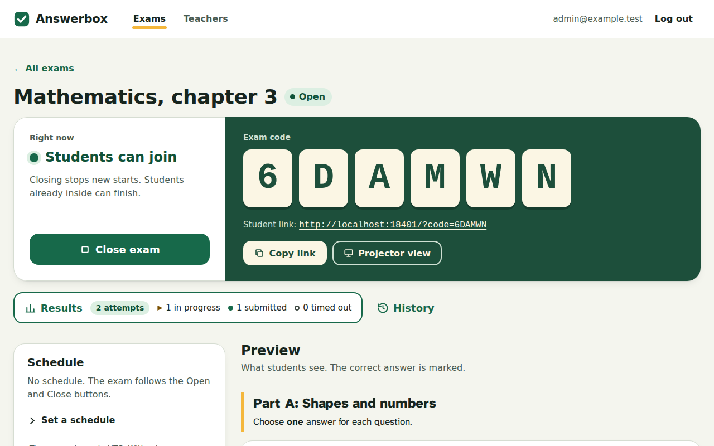
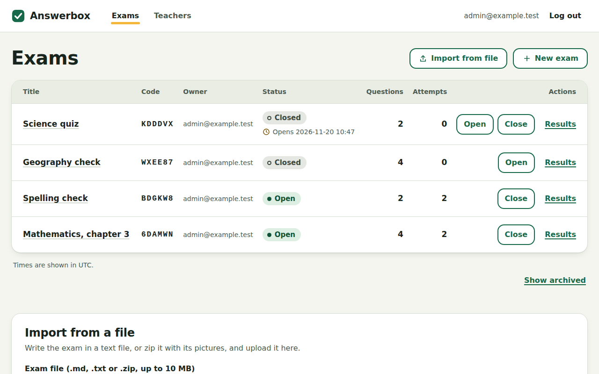
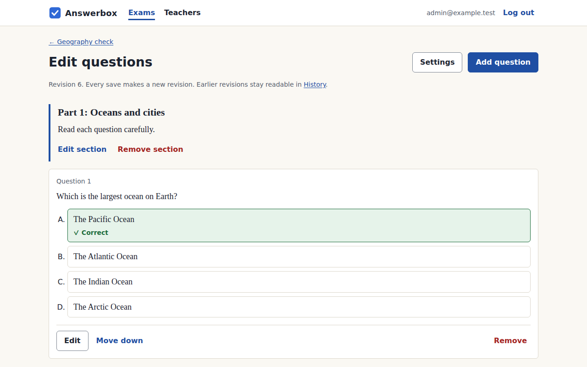
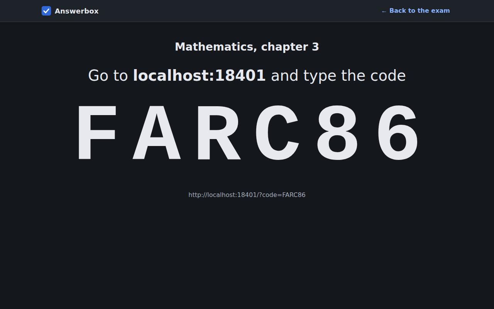

# Answerbox

**Run the exam. Skip the marking.**

Answerbox is a small, self-hosted web app for classroom exams. Students join with a 6-character code on the phones they already have, with no accounts and nothing to install. You write or import the questions, open the exam, and watch the results come in while they work. Multiple choice and fill-in answers are scored for you.

<p>
  
  
  
</p>



## Why Answerbox

- **Less marking.** Multiple choice is scored on submit. Fill-in answers match ignoring case and spacing, and numbers written the Indonesian way match by value (`1.003` = `1003`, `0,5` = `0,50`). You can still mark a typed answer right or wrong by hand.
- **Works on what students have.** Any phone or laptop with a browser. Answers save as they go, and a resume code brings a student back after a closed browser or a flat battery, even on another device.
- **You see the room.** Results refresh while students work. An optional monitor tells you when a student leaves the page or tries to copy and paste.
- **Your data stays with you.** One Go binary and one SQLite file on your own server. No third-party scripts, no trackers, no student accounts.

## What you get

| For students | For teachers |
| --- | --- |
| Join with a code or a link, no account | Sign in with Google; admins manage the teacher list |
| One page with a timer, saved state and a question navigator | Write exams in the browser or import a text file, with images |
| Multiple choice and short typed answers | Sections with their own instructions |
| Score, or score plus a review, as you choose | Open and close by hand or on a schedule, several exams at once |
| Light and dark, readable type, big tap targets | A projector view of the code for the room |
| Resume an interrupted exam anywhere | Results with filters, per-section scores and a CSV export |
| | Every change saved as a revision; download, copy and archive exams |

| | |
| --- | --- |
|  |  |
| The exams list | Results, updated while students work |
|  |  |
| The editor | The projector view |

## Try it in two minutes

You need Go 1.26 or later. Start the fake sign-in provider in one terminal:

```sh
go run ./cmd/oidcfake
```

Start Answerbox in another:

```sh
ANSWERBOX_GOOGLE_CLIENT_ID=dev-client ANSWERBOX_GOOGLE_CLIENT_SECRET=dev-secret \
ANSWERBOX_ADMIN_EMAILS=admin@example.test ANSWERBOX_PUBLIC_URL=http://localhost:8080 \
ANSWERBOX_OIDC_ISSUER=http://127.0.0.1:9096 ANSWERBOX_DATA_DIR=./data go run ./cmd/answerbox
```

1. Open `http://localhost:8080/admin`, press **Sign in with Google** and sign in as `admin@example.test`.
2. **Import from file** → [`docs/sample-exam.md`](docs/sample-exam.md) → **Import exam**.
3. Press **Open exam** and note the code.
4. In a private window, open `http://localhost:8080/`, type the code and a name, and press **Start exam**.

> The fake provider signs in anyone. It is for trying the app locally and is not in the container image.

## Self-hosting

The image `ghcr.io/fiatcode-gh/answerbox` holds a single static binary, runs as a non-root user (65532) and keeps everything in `/data`.

```sh
podman volume create answerbox-data
podman run -d --name answerbox -p 8080:8080 \
  --env-file .env -v answerbox-data:/data \
  ghcr.io/fiatcode-gh/answerbox:latest
```

Students use `/`, teachers use `/admin`. Put it behind a reverse proxy that terminates HTTPS: cookies are always `Secure`.

### Settings

All settings are environment variables; [`.env.example`](.env.example) lists them with a short note each. The app refuses to start without the first four.

| Variable | Default | Meaning |
| --- | --- | --- |
| `ANSWERBOX_GOOGLE_CLIENT_ID` | required | OAuth client ID of a Google "Web application" client |
| `ANSWERBOX_GOOGLE_CLIENT_SECRET` | required | Its client secret |
| `ANSWERBOX_ADMIN_EMAILS` | required | Comma-separated admin emails |
| `ANSWERBOX_PUBLIC_URL` | required | Public address, for example `https://exam.example.org` |
| `ANSWERBOX_TIME_ZONE` | `UTC` | IANA time zone for schedules and shown times |
| `ANSWERBOX_DATA_DIR` | `./data` (image: `/data`) | Database and uploaded images |
| `ANSWERBOX_LISTEN_ADDR` | `:8080` | Listen address |
| `ANSWERBOX_TRUSTED_PROXIES` | none | CIDRs whose `X-Forwarded-For` is trusted in the request log |
| `ANSWERBOX_OIDC_ISSUER` | Google | Another OpenID provider, or the local fake |

**Google sign-in:** create an OAuth client of type "Web application" with the redirect URI `<ANSWERBOX_PUBLIC_URL>/admin/auth/callback`. The first admin signs in at `/admin` and adds teachers on the Teachers page. Only verified emails on that list can sign in.

**Backup:** everything lives in the data directory: `answerbox.db` (SQLite, WAL mode) and `media/`. While the app runs:

```sh
sqlite3 "$data/answerbox.db" ".backup '$dest'"
cp -a "$data/media" "$backup/"
```

**Health check:** `GET /healthz` answers `200 ok`, or `503` when the database is unavailable.

**Browsers:** tested in Chromium on desktop and Chrome on Android. Safari is not tested.

## Documentation

- [Teacher guide](docs/guide.md): codes, schedules, the editor, sections, fill-in questions, revisions, results and archive.
- [Exam file format](docs/exam-format.md): write an exam in any text editor.
- [Development](docs/development.md): checks, tests and the browser scripts.
- [Decision record](docs/decisions/answerbox.md): why things are the way they are, and the known limits.
